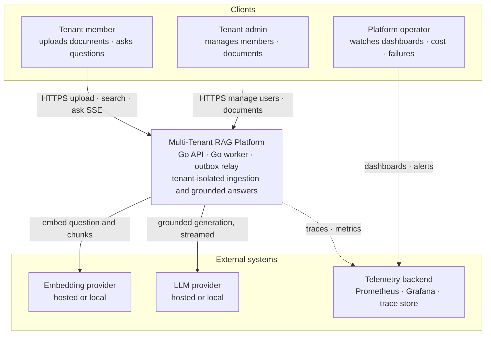
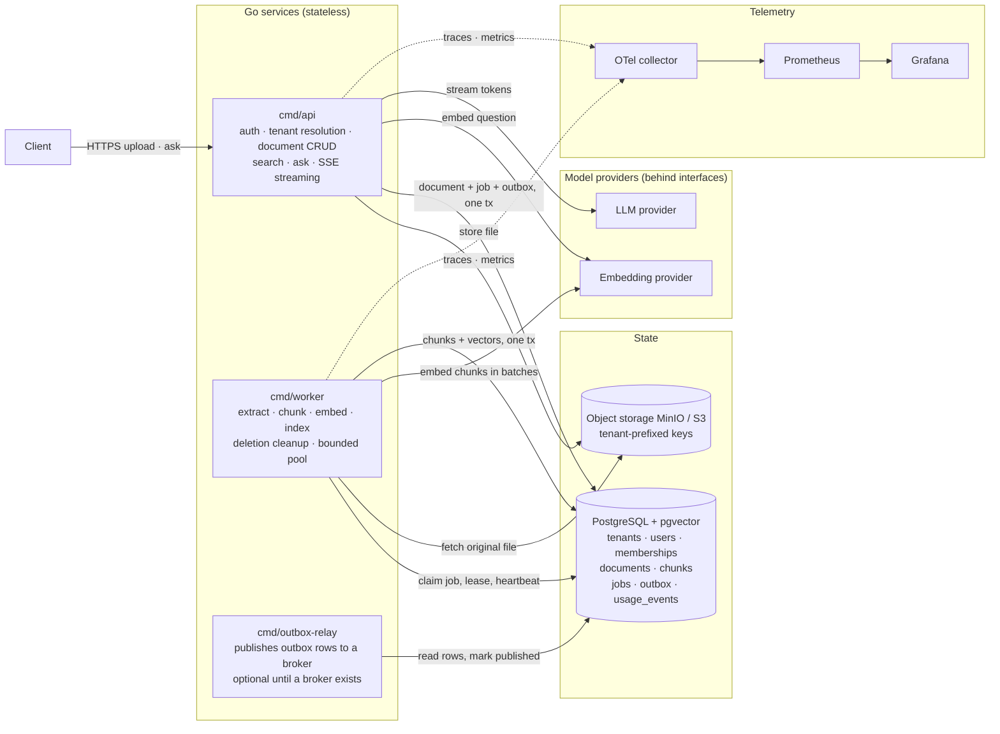
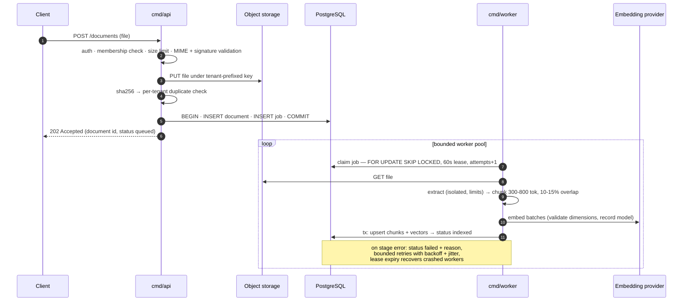
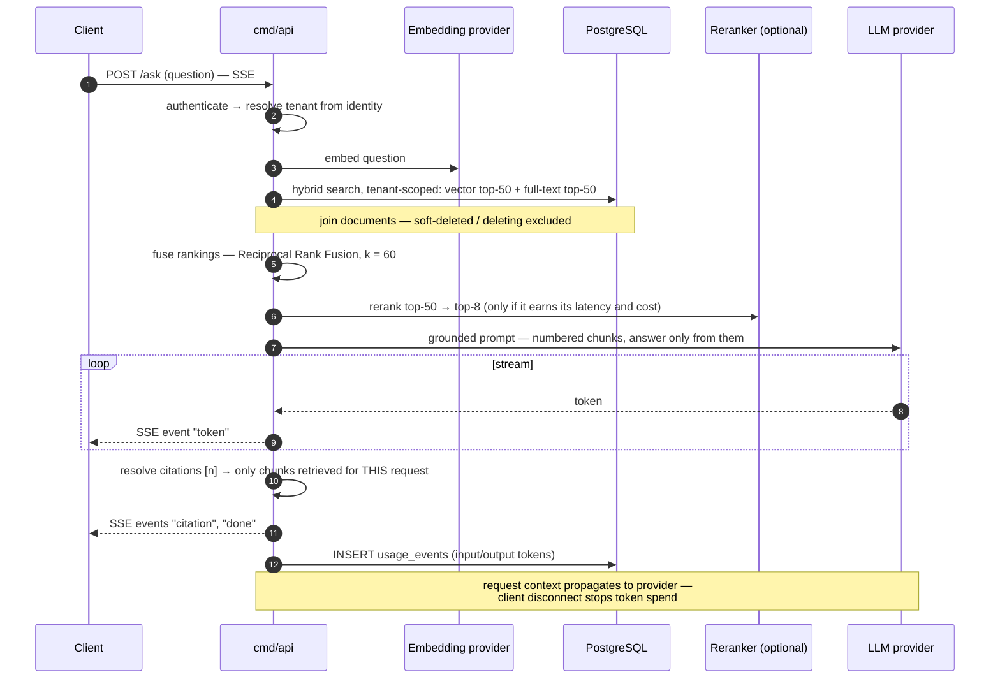
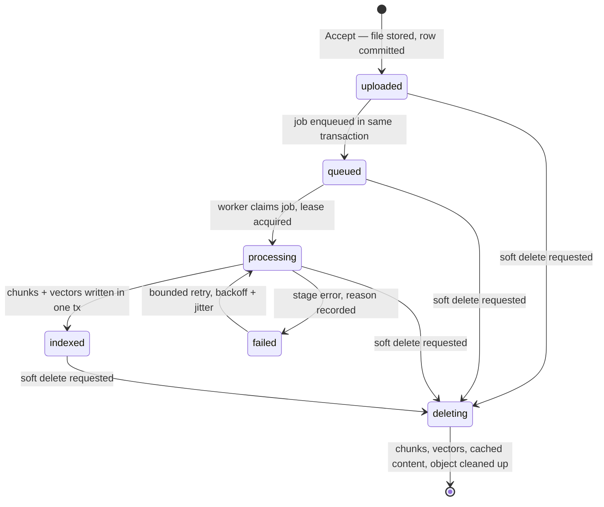
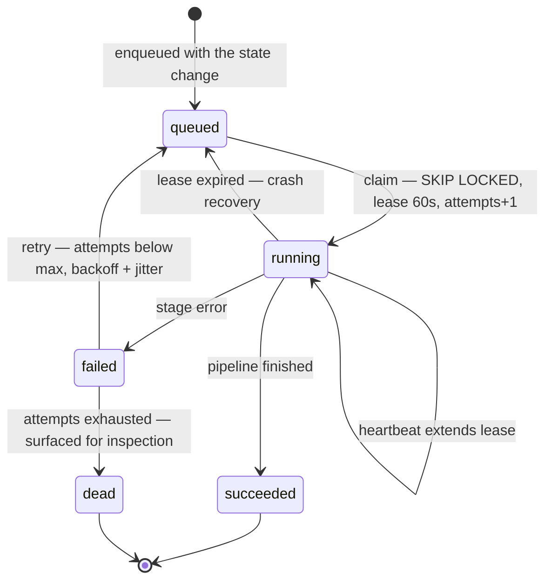
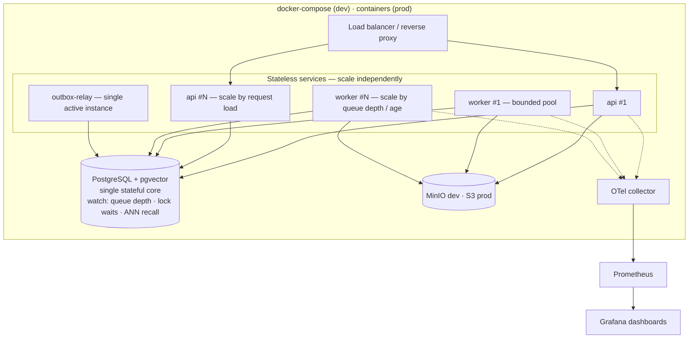
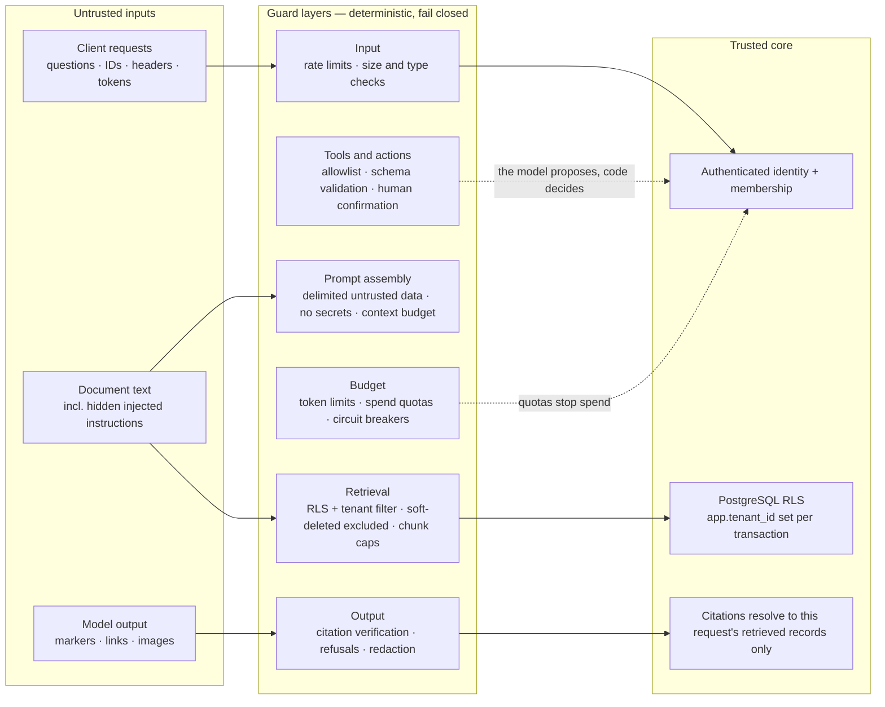

# Architecture Diagrams

> Multi-Tenant RAG Platform in Go — visual architecture reference.
> All diagrams are [Mermaid](https://mermaid.js.org/) and render natively on GitHub.
>
> Companion docs: [System Architecture](../system-architecture.md) ·
> [System Design](../system-design.md) · [Technology Stack](../tech-stack.md)

## Contents

1. [System context (C4 — level 1)](#1-system-context-c4--level-1)
2. [Container diagram (C4 — level 2)](#2-container-diagram-c4--level-2)
3. [Write path — asynchronous ingestion (sequence)](#3-write-path--asynchronous-ingestion-sequence)
4. [Read path — ask with SSE streaming (sequence)](#4-read-path--ask-with-sse-streaming-sequence)
5. [State machines — document status and job lifecycle](#5-state-machines--document-status-and-job-lifecycle)
6. [Deployment view (Docker Compose)](#6-deployment-view-docker-compose)
7. [Trust boundaries and guard layers](#7-trust-boundaries-and-guard-layers)

---

## 1. System context (C4 — level 1)

Who uses the platform and which external systems it depends on. Everything inside the
platform box enforces tenant isolation server-side.

---

## 2. Container diagram (C4 — level 2)

Three Go binaries share `internal/` packages and scale/fail independently. PostgreSQL is the
only stateful core: relational data, vectors, keyword search, job queue, and outbox.

---

## 3. Write path — asynchronous ingestion (sequence)

Everything left of the index is about getting trustworthy data in. Ingestion is an idempotent
state machine: a crash and retry cannot corrupt a document.

---

## 4. Read path — ask with SSE streaming (sequence)

Everything right of the index is about getting a grounded, attributable answer out. The tenant
always comes from the authenticated identity — never from a request field.

---

## 5. State machines — document status and job lifecycle

### Document status

### Job lifecycle

---

## 6. Deployment view (Docker Compose)

Notes:

- Workers shut down gracefully: in-flight jobs finish (`WaitGroup`); abandoned jobs are
  recovered via lease expiry — restarting a worker never corrupts document state.
- A broker (Kafka / NATS) can later replace the in-Postgres queue via the transactional
  outbox; consumers stay idempotent.

---

## 7. Trust boundaries and guard layers

**Core rule: the model is not a security boundary.** Hard guarantees live in deterministic
code and the database; model-based checks are an extra, probabilistic layer. Guards **fail
closed**: an error or timeout blocks the response.

Canary check: every test tenant's documents carry a unique meaningless token — if tenant A's
answers ever contain tenant B's canary, there is a leak.

---

## Viewing / editing

- GitHub renders all diagrams above natively — no tooling needed.
- To iterate on a diagram, paste its Mermaid source into [mermaid.live](https://mermaid.live).
