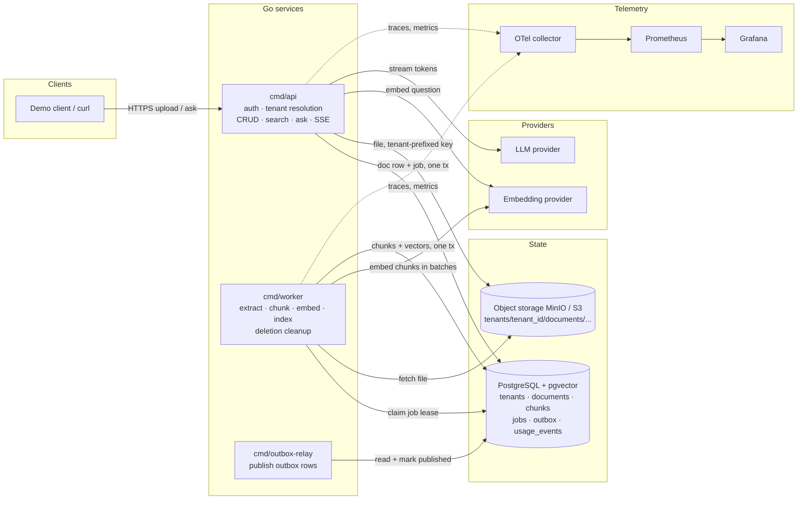
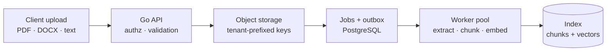
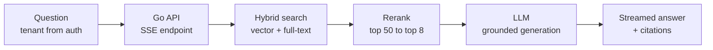
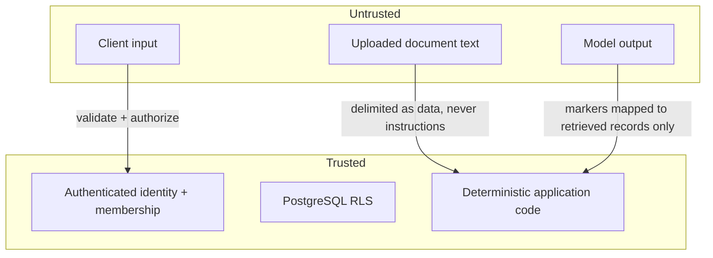

# System Architecture

> Multi-Tenant RAG Platform in Go — how the system is composed, how data moves, and where the
> trust boundaries are.

## Overview

More than a document chatbot: an **asynchronous, observable Retrieval-Augmented Generation
platform** that serves many companies, teams, or customers (tenants) without leaking one
tenant's data into another's answers.

Three Go binaries share the same `internal/` packages. They **scale and fail independently**.

| Binary              | Responsibility                                                                                                          |
| ------------------- | ----------------------------------------------------------------------------------------------------------------------- |
| `cmd/api`           | HTTP API: authentication, tenant resolution, document CRUD, upload, search and ask endpoints, SSE streaming.             |
| `cmd/worker`        | Claims jobs and runs the ingestion pipeline: extract, chunk, embed, index. Also handles deletion cleanup.                 |
| `cmd/outbox-relay`  | Publishes outbox rows to a broker (optional until you introduce one).                                                    |

## High-level component view



## The two paths

Both paths share **one index**. Everything left of the index is about getting trustworthy data
in; everything right of it is about getting a grounded, attributable answer out. Every query,
job, object key, and citation carries a **tenant identifier that is enforced server-side**.

### Write path (asynchronous)



1. The client uploads a file. The API checks the user's membership in the tenant, enforces
   size limits, and validates type **by signature as well as MIME**.
2. The file is stored under a **tenant-prefixed object key**.
3. In a **single database transaction**, the API inserts the document row and enqueues an
   ingestion job (plus an outbox row if a broker is in play).
4. A worker claims the job, extracts text, chunks it, embeds the chunks in batches, and writes
   chunks and vectors.
5. The document status moves to `indexed`, or to `failed` with a recorded reason.

### Read path (synchronous, streamed)



1. The API resolves the tenant **from the authenticated identity**, never from an unchecked
   request field.
2. It embeds the question, runs vector and full-text search scoped to the tenant, and fuses
   the rankings (Reciprocal Rank Fusion).
3. An optional reranker narrows the candidates.
4. The selected chunks are numbered and placed into a grounded prompt.
5. Tokens stream to the client over SSE; citations are resolved from the retrieval records and
   returned.

## Responsibilities by layer

| Layer                | Owned by        | Notes                                                                 |
| -------------------- | --------------- | --------------------------------------------------------------------- |
| Authentication       | `cmd/api`       | JWT/session → user identity.                                          |
| Tenant resolution    | `cmd/api`       | From authenticated identity + membership check, per request.          |
| Row-level isolation  | PostgreSQL RLS  | `FORCE ROW LEVEL SECURITY` + `app.tenant_id` per transaction.          |
| Storage isolation    | `cmd/api`       | Prefixed keys; access checked before any signed URL is issued.         |
| Ingestion state machine | `cmd/worker` | Idempotent stages; crash + retry cannot corrupt a document.            |
| Job leases / retries | PostgreSQL      | `FOR UPDATE SKIP LOCKED` claim, lease expiry, bounded retries.         |
| Cost control         | API middleware  | Per-tenant quotas, concurrency caps, token budgets.                    |
| Output safety        | guard pipeline  | Citation verification, groundedness/refusal checks, redaction — fail closed. |

## Trust boundaries



- **Retrieved text is untrusted data, however well it is labelled.** Prompt instructions help
  but are not a security boundary — enforce authorization in application code.
- The model only emits citation markers like `[2]`; your code maps markers back to chunk
  records retrieved *for this request*, drops invented ones, and re-checks access when a
  citation is resolved to a document or page.

## Internal package layout

```text
contexthub/
├── cmd/
│   ├── api/
│   │   └── main.go
│   ├── worker/
│   │   └── main.go
│   └── outbox-relay/
│       └── main.go
├── internal/
│   ├── auth/
│   ├── tenants/
│   ├── documents/
│   ├── ingestion/
│   │   ├── extract/
│   │   ├── chunk/
│   │   └── embed/
│   ├── jobs/
│   ├── messaging/
│   ├── retrieval/
│   ├── reranking/
│   ├── llm/
│   ├── conversations/
│   ├── observability/
│   └── storage/
├── migrations/
├── api/
│   └── openapi.yaml
├── deployments/
│   └── docker-compose.yml
├── tests/
│   ├── integration/
│   ├── isolation/
│   └── evaluation/
├── scripts/
├── docs/
│   └── architecture.md
├── go.mod
├── go.sum
├── Makefile
└── README.md
```

This is a suggested layout, not a requirement to create every directory on day one. Code is
organized around **responsibilities** rather than one big `main.go`. Interfaces stay small —
the RAG application depends on an embedding interface rather than a particular provider's SDK.

## Deployment view (Docker Compose)

| Container       | Role                                       |
| --------------- | ------------------------------------------ |
| `api`           | Stateless; scale horizontally behind LB.   |
| `worker`        | Stateless; bounded pool per instance; scale by queue depth. |
| `outbox-relay`  | Single active instance is sufficient early.|
| `postgres`      | Single stateful core (pgvector image).     |
| `minio`         | Object storage for dev; S3 in production.  |
| `otel-collector`, `prometheus`, `grafana` | Telemetry pipeline. |

Graceful shutdown: workers finish in-flight jobs (`sync.WaitGroup`) and rely on lease expiry
for anything abandoned, so restarting a worker never corrupts document state.

## Scaling & failure independence

- **API** scales on request load; it holds no state beyond DB pools.
- **Worker** scales on queue depth/age; bounded by semaphore so a claimed job never waits on
  capacity.
- **Postgres** is the shared core — the first real bottleneck and the first thing to monitor
  (queue depth, lock waits, ANN recall).
- A broker (Kafka/NATS) can replace the in-Postgres queue later via the transactional outbox,
  with consumers staying idempotent.

## Related docs

- [Architecture Diagrams](diagrams/architecture.md) — visual reference: context, containers, sequence paths, state machines, deployment, trust boundaries
- [Technology Stack](tech-stack.md) — tools, rationale, swap points
- [System Design](system-design.md) — data model, tenancy, pipeline, retrieval, guardrails
