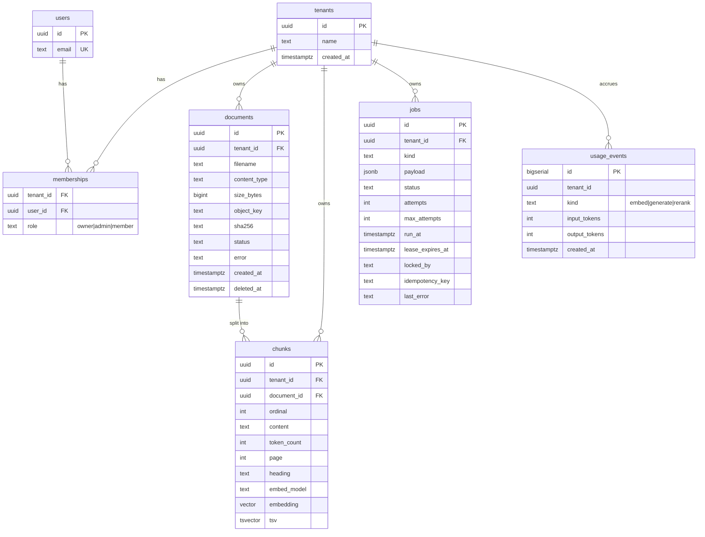

# System Design

> Multi-Tenant RAG Platform in Go — the detailed design: tenancy model, data model, ingestion
> pipeline, jobs, retrieval, generation, observability, and guardrails.

## 1. Multi-tenancy model

Shared schema where every tenant-owned row has a `tenant_id`. Defended in **three layers** so a
single bug does not become a data leak:

1. **Application authorization.** Resolve the tenant from the authenticated identity and
   verify membership and role on every request.
2. **Row-level security (RLS).** The database refuses to return or write rows outside the
   current tenant, even if a query forgets its `WHERE` clause.
3. **Storage isolation.** Object keys are prefixed
   (`tenants/{tenant_id}/documents/{document_id}`) and access is checked before any signed URL
   is issued.

### RLS policy

```sql
-- migrations/0002_rls.sql
ALTER TABLE documents ENABLE ROW LEVEL SECURITY;
ALTER TABLE documents FORCE ROW LEVEL SECURITY;

CREATE POLICY tenant_isolation ON documents
  USING      (tenant_id = current_setting('app.tenant_id', true)::uuid)
  WITH CHECK (tenant_id = current_setting('app.tenant_id', true)::uuid);

-- Repeat for chunks, jobs, usage_events, and every tenant-owned table.
```

### Transaction-scoped tenant context

```go
// internal/storage/tenant_tx.go
func (s *Store) WithTenant(ctx context.Context, tenantID uuid.UUID, fn func(pgx.Tx) error) error {
    tx, err := s.pool.Begin(ctx)
    if err != nil {
        return err
    }
    defer tx.Rollback(ctx)

    // is_local = true: the setting lives only for this transaction,
    // so a pooled connection never carries a tenant into the next request.
    if _, err := tx.Exec(ctx, "SELECT set_config('app.tenant_id', $1, true)", tenantID.String()); err != nil {
        return err
    }
    if err := fn(tx); err != nil {
        return err
    }
    return tx.Commit(ctx)
}
```

Workers and background jobs use the same wrapper.

### Three common RLS mistakes (avoid these)

- Connecting as a **superuser or the table owner** bypasses RLS unless you use
  `FORCE ROW LEVEL SECURITY` and a dedicated application role.
- Setting the tenant **outside a transaction** leaks it across pooled connections.
- Workers/background jobs also need a tenant context — give them the same wrapper.

## 2. Data model

Start with the smallest schema that supports the pipeline. Record which embedding model
produced each vector so you can re-embed later.

### Entity relationships



### Key design decisions

| Table       | Decision                                                                                                   |
| ----------- | ---------------------------------------------------------------------------------------------------------- |
| `documents` | `UNIQUE (tenant_id, sha256)` — per-tenant duplicate detection. `status` CHECK: `uploaded → queued → processing → indexed | failed`, plus soft delete (`deleted_at`). |
| `chunks`    | `UNIQUE (document_id, ordinal)` — **makes retries idempotent**. `tsv` is a generated column
(`to_tsvector('english', content)`). `embedding vector(1536)` must match the embedding model's
dimension. `embed_model` recorded for future re-embedding. |
| Indexes     | `hnsw (embedding vector_cosine_ops)` for ANN, `gin (tsv)` for full text, `(tenant_id, document_id)` for scoped access. |
| `jobs`      | `UNIQUE (tenant_id, idempotency_key)`; lease columns (`lease_expires_at`, `locked_by`) for crash recovery; `attempts` / `max_attempts` for bounded retries. |
| `outbox`    | `published_at` nullable; relay marks rows published.                                                        |

### Filtered vector search caveat

An approximate index scans nearest neighbors first and applies the tenant filter afterward, so
a small tenant can get fewer results than requested. Check whether your pgvector version offers
iterative index scans, test with your smallest tenant, and consider partitioning for very large
tenants.

## 3. Ingestion pipeline

Treat ingestion as a **state machine**. Each stage is idempotent, so a crash and retry cannot
corrupt a document.

| Stage  | What happens                                            | Design notes                                                                                       |
| ------ | ------------------------------------------------------- | -------------------------------------------------------------------------------------------------- |
| Accept | Validate, store the object, insert document and job in one transaction. | Hash the file to detect duplicates per tenant. Never enqueue a job for a document row that failed to commit. |
| Extract | Convert the file to text with page and heading metadata. | Run parsers in isolation with memory and time limits. Parsers are a common attack surface.          |
| Chunk  | Split into passages of roughly 300–800 tokens with 10–15% overlap. | Prefer paragraph and heading boundaries. Keep the ordinal stable so reprocessing upserts the same rows. |
| Embed  | Send chunks to the embedding provider in batches.       | Validate each returned vector's dimension. Record the model name. Respect rate limits with bounded retries. |
| Index  | Write chunks and vectors, then mark the document `indexed`. | Do both in one transaction and check the document has not been deleted meanwhile.                   |

Chunk size is a **tuning knob, not a constant**. Start with the ranges above and let the
evaluation set tell you whether to change them.

Document status machine:

```text
uploaded ──▶ queued ──▶ processing ──▶ indexed
                           │
                           └──▶ failed (with recorded reason)

any state ──▶ (soft) deleted  ──▶ physical cleanup (chunks, vectors, object)
```

Deletion is more than removing metadata: clean up chunks, vectors, cached content, associated
objects, and derived artifacts per the retention policy — and account for in-flight jobs so a
worker cannot reinsert deleted content after cleanup finishes.

## 4. Jobs and messaging

A PostgreSQL-backed queue gives transactional enqueue and is enough for a long time. Workers
claim jobs with a **lease** so abandoned work is recovered automatically.

### Claiming a job

```sql
-- internal/jobs/claim.sql
UPDATE jobs
SET status = 'running',
    locked_by = $1,
    lease_expires_at = now() + interval '60 seconds',
    attempts = attempts + 1
WHERE id = (
  SELECT id FROM jobs
  WHERE (status = 'queued'  AND run_at <= now())
     OR (status = 'running' AND lease_expires_at < now())
  ORDER BY run_at
  FOR UPDATE SKIP LOCKED
  LIMIT 1
)
RETURNING id, tenant_id, kind, payload, attempts, max_attempts;
```

### Worker core loop

```go
// cmd/worker/main.go (core loop)
sem := make(chan struct{}, cfg.Concurrency) // bounded worker pool
var wg sync.WaitGroup

for ctx.Err() == nil {
    sem <- struct{}{} // reserve capacity before claiming, so a claimed job never waits
    job, err := queue.Claim(ctx, workerID)
    if err != nil { // includes "no jobs available"
        <-sem
        sleepWithJitter(ctx, cfg.PollInterval)
        continue
    }
    wg.Add(1)
    go func() {
        defer wg.Done()
        defer func() { <-sem }()
        w.Process(ctx, job) // heartbeat, run stages, mark succeeded or schedule retry
    }()
}
wg.Wait() // graceful shutdown: finish in-flight jobs
```

- While a job runs, the worker **extends its lease with a heartbeat**.
- If attempts reach `max_attempts`, mark the job `dead` and surface it for inspection rather
  than retrying forever.
- Retry delays grow **exponentially with jitter**.

### When you add a broker

Use the **transactional outbox** pattern: write an outbox row in the same transaction as the
state change, and let `outbox-relay` publish it. Delivery is at-least-once, so every consumer
must be idempotent — use idempotency keys and unique constraints so a duplicate event does
nothing.

## 5. Hybrid retrieval

Vector search finds passages that *mean* the same thing as the question. Full-text search finds
exact names, error codes, and rare terms. Run both and fuse the rankings with **Reciprocal Rank
Fusion**: each result scores the sum of `1 / (k + rank)` across lists, with `k` commonly 60. It
needs no score normalization, which is why it works well across two very different scoring
systems.

```sql
-- internal/retrieval/hybrid.sql
WITH vec AS (
  SELECT id, row_number() OVER (ORDER BY embedding <=> $2) AS rnk
  FROM chunks
  WHERE tenant_id = $1
  ORDER BY embedding <=> $2
  LIMIT 50
),
fts AS (
  SELECT id, row_number() OVER (ORDER BY ts_rank_cd(tsv, q) DESC) AS rnk
  FROM chunks, websearch_to_tsquery('english', $3) AS q
  WHERE tenant_id = $1 AND tsv @@ q
  ORDER BY ts_rank_cd(tsv, q) DESC
  LIMIT 50
)
SELECT c.id, c.document_id, c.content, c.page, c.heading,
       COALESCE(1.0 / (60 + vec.rnk), 0) + COALESCE(1.0 / (60 + fts.rnk), 0) AS score
FROM chunks c
LEFT JOIN vec ON vec.id = c.id
LEFT JOIN fts ON fts.id = c.id
WHERE c.tenant_id = $1
  AND (vec.id IS NOT NULL OR fts.id IS NOT NULL)
ORDER BY score DESC
LIMIT $4;
```

- Join to `documents` and **exclude soft-deleted or `deleting` documents** so removed content
  can never be retrieved.
- Then optionally rerank the top candidates with a cross-encoder or an LLM, keeping the best
  handful for the prompt. **Measure whether reranking earns its latency and cost before keeping
  it.**

## 6. Generation, streaming, and citations

### Grounded prompt

Number each retrieved chunk and tell the model to answer only from them, cite by number, and
say so when the context is insufficient. Retrieved text goes in as **clearly delimited data —
it is untrusted, however well it is labelled**.

### Streaming over SSE

```go
// internal/conversations/handler.go
func (h *Handler) Ask(w http.ResponseWriter, r *http.Request) {
    fl, ok := w.(http.Flusher)
    if !ok {
        http.Error(w, "streaming unsupported", http.StatusInternalServerError)
        return
    }
    ctx := r.Context() // cancelled automatically when the client disconnects
    tenant := auth.TenantFrom(ctx)

    hits, err := h.retriever.Search(ctx, tenant, question)
    if err != nil {
        http.Error(w, "retrieval failed", http.StatusBadGateway)
        return
    }

    w.Header().Set("Content-Type", "text/event-stream")
    w.Header().Set("Cache-Control", "no-cache")

    for ev := range h.gen.Stream(ctx, buildRequest(question, hits)) {
        if ev.Err != nil {
            writeSSE(w, "error", []byte(`{"message":"generation failed"}`))
            fl.Flush()
            return
        }
        writeSSE(w, ev.Kind, ev.Data) // "token", "citation", or "done"
        fl.Flush()
    }
}

func writeSSE(w io.Writer, event string, data []byte) {
    fmt.Fprintf(w, "event: %s\ndata: %s\n", event, data)
}
```

- Pass the request context all the way into the provider call so a **disconnected client stops
  spending tokens**.
- Record final token usage in `usage_events` when the stream ends.

### Citations you can trust

The model only emits markers like `[2]`. Your code maps each marker back to the chunk records
retrieved for this request, drops any marker that does not exist, and re-checks access when a
citation is later resolved to a document or page. **Never let the model invent a source
identifier.**

```go
// internal/conversations/citations.go
var marker = regexp.MustCompile(`\[(\d+)\]`)

// Keep only citations that point at chunks retrieved for THIS request and tenant.
func ResolveCitations(answer string, hits []Hit) []Citation {
    seen := map[int]bool{}
    var out []Citation
    for _, m := range marker.FindAllStringSubmatch(answer, -1) {
        n, _ := strconv.Atoi(m[1])
        if n < 1 || n > len(hits) || seen[n] {
            continue // invented or duplicate marker
        }
        seen[n] = true
        out = append(out, Citation{N: n, ChunkID: hits[n-1].ID, DocumentID: hits[n-1].DocumentID})
    }
    return out
}
```

## 7. Observability

Goal: **explain the latency and failure of any request from its telemetry alone.** Propagate
trace context from the API through the job payload into the worker.

| Signal          | What to capture                                                                                                          |
| --------------- | ------------------------------------------------------------------------------------------------------------------------ |
| Query trace     | Spans for embed question, vector search, full-text search, fusion, rerank, and LLM first-token and total time.            |
| Ingestion trace | Spans for claim, extract, chunk, embed batches, and index write, linked to the upload request.                            |
| Metrics         | Request latency histograms, job queue depth and age, job attempts and failures, provider errors and rate limits, tokens and estimated cost per tenant. |
| Logs            | Structured, with request, tenant, document, and job identifiers. **Never log document text or secrets.**                   |

Keep metric label cardinality in check: tenant identifiers are fine for a few hundred tenants,
but document or user identifiers belong in traces and logs, not metric labels.

## 8. Evaluation

Without a test set, "better retrieval" is a feeling. Build a small **golden dataset** early and
run it on every change.

```jsonl
// tests/evaluation/golden.jsonl
{"tenant":"acme","question":"What is the refund window?","relevant_chunks":["...chunk ids..."]}
{"tenant":"acme","question":"Who won the 2018 World Cup?","relevant_chunks":[],"refusal":true}
```

- **Retrieval:** recall@k, MRR, and nDCG against the labelled chunks.
- **Answers:** faithfulness to the retrieved context and correctness against the reference.
  LLM judges help, but spot-check them by hand.
- **Citations:** every marker maps to a real, authorized chunk that supports the sentence.
- **Refusals:** out-of-scope questions are declined rather than answered from model memory.

## 9. Production security and reliability

A system can produce accurate answers and still be unsafe. Treat these as production
requirements:

| Risk                          | Mitigation                                                                        |
| ----------------------------- | ---------------------------------------------------------------------------------- |
| Cross-tenant data leakage     | Tenant-aware queries, authorization checks, RLS, isolation tests                    |
| Malicious uploaded files      | File-size limits, MIME and signature validation, parser isolation, malware scanning where appropriate |
| Prompt injection in documents | Treat retrieved content as untrusted; restrict tools and privileged actions         |
| Unauthorized citations        | Generate citations from authorized retrieval records and verify access when resolving them |
| Duplicate jobs                | Idempotency keys, unique constraints, transactional state changes                   |
| Provider outages              | Timeouts, bounded retries, exponential backoff, circuit breaking where useful       |
| Excessive LLM spending        | Per-tenant quotas, concurrency limits, token budgets, cost monitoring               |
| Memory exhaustion             | Bounded worker pools, streaming parsers where possible, document and chunk limits   |
| Stuck jobs                    | Leases, heartbeats, recovery of abandoned work, retry limits                        |
| Accidental deletion           | Authorization, soft deletion where appropriate, retention and backup policies       |

### Prompt injection

A document may contain text instructing the model to reveal secrets or ignore its system
prompt. Prompt instructions help, but they are **not a complete security boundary**. Do not
expose privileged tools merely because the model asks to use them. Enforce authorization in
application code and require explicit validation before consequential actions.

## 10. Guardrails (defense in depth)

**The core rule: the model is not a security boundary.** Anything a model is merely *asked* to
do ("never reveal other tenants' data") it can be talked out of. Put hard guarantees in
deterministic code and the database; use model-based checks as an extra, probabilistic layer —
and measure them as such.

| Layer             | Guardrails                                                                                                                 | Enforced by            |
| ----------------- | --------------------------------------------------------------------------------------------------------------------------- | ---------------------- |
| Input             | Per-user and per-tenant rate limits, maximum question length, maximum upload size, allowed file types, abuse detection on repeated probing. | API middleware         |
| Retrieval         | Tenant filter and RLS, document-level permissions where needed, soft-deleted documents excluded, a cap on chunks per document so one file cannot dominate results. | SQL and application code |
| Prompt assembly   | Retrieved text delimited as untrusted data, no secrets or keys in prompts, context size budget.                             | Application code       |
| Tools and actions | Least privilege, an allowlist of tools, schema validation of arguments, tenant-bound credentials, human confirmation for consequential actions. The model proposes; your code decides. | Application code       |
| Output            | Citation verification, groundedness and refusal checks, redaction of secret and personal-data patterns, no automatic loading of model-written images or links, HTML escaping in the client. | Output guard stage     |
| Budget            | Token limits per request, spend quotas per tenant, concurrency caps, circuit breakers on providers.                          | Middleware and quota service |

Model the checks as a small pipeline of stages. **Fail closed:** if a guard errors or times
out, block the response rather than letting it through.

```go
// internal/guard/guard.go
type Verdict int

const (
    Allow Verdict = iota
    Redact
    Block
)

type Guard interface {
    Name() string
    // Returns the verdict and the (possibly cleaned) text.
    Check(ctx context.Context, text string) (Verdict, string, error)
}

// Run executes stages in order. The first Block wins; Redact output feeds the next stage.
func Run(ctx context.Context, text string, stages ...Guard) (Verdict, string, error) {
    final := Allow
    for _, g := range stages {
        v, out, err := g.Check(ctx, text)
        if err != nil {
            return Block, "", fmt.Errorf("guard %s: %w", g.Name(), err) // fail closed
        }
        switch v {
        case Block:
            return Block, "", nil
        case Redact:
            final, text = Redact, out
        }
    }
    return final, text, nil
}
```

**Citation verification is the most valuable deterministic output guard** — the model may only
point at chunks you retrieved for this request.

## 11. Testing strategy

Four distinct types of tests:

- **Unit:** chunk boundaries and metadata extraction; retry/backoff decisions; RRF ranking and
  citation mapping; cost calculations and usage aggregation.
- **Integration:** PostgreSQL queries and migrations; file storage and document processing;
  message publishing/consumption; embedding and generation adapters; SSE behavior and client
  cancellation.
- **Security:** cross-tenant document access; cross-tenant retrieval and citations;
  unauthorized job inspection and deletion; forged tenant identifiers; prompt injection and
  tool authorization.
- **Failure and load:** kill a worker mid-job; disconnect broker/database temporarily;
  simulate provider rate limits and timeouts; send duplicate events; upload malformed and
  oversized files; concurrent requests measuring p95 latency, error rate, and resource usage.

Run `go test ./...` and `go test -race ./...` regularly. The race detector catches certain
memory-access races but does not prove distributed job processing is correct.

**Canary strings:** plant a unique, meaningless token in each test tenant's documents. If
tenant A's answers ever contain tenant B's canary, you have a leak.

## Related docs

- [Architecture Diagrams](diagrams/architecture.md) — visual reference: context, containers, sequence paths, state machines, deployment, trust boundaries
- [Technology Stack](tech-stack.md) — tools, rationale, swap points
- [System Architecture](system-architecture.md) — binaries, paths, deployment view
